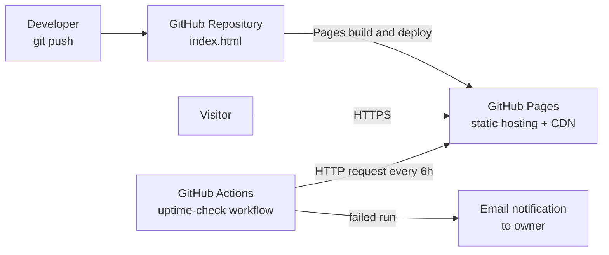

# SWYNEX – Final Cloud Deployment
### Cloud Deployment Case Study · SWYNEX Cloud Internship, Task 4

**Author:** Mahesh Sakharam Kshirsagar
**Live URL:** https://kshirsagar-mahesh.github.io/SWYNEX-Basic-Cloud-Deployment/
**Host:** GitHub Pages (static-site PaaS)

---

## 1. Summary

This case study brings together the four internship tasks into one end-to-end cloud deployment story: **design** a cloud architecture, **deploy** a working application, **monitor** it with cost and security awareness, and **reflect** on what was learned.

| Task | Focus | Repository |
|---|---|---|
| Task 1 | Cloud Architecture Outline | [SWYNEX-Cloud-Architecture-Outline](https://github.com/kshirsagar-mahesh/SWYNEX-Cloud-Architecture-Outline) |
| Task 2 | Basic Cloud Deployment | [SWYNEX-Basic-Cloud-Deployment](https://github.com/kshirsagar-mahesh/SWYNEX-Basic-Cloud-Deployment) |
| Task 3 | Monitoring and Cost Awareness | [SWYNEX-Monitoring-and-Cost-Awareness](https://github.com/kshirsagar-mahesh/SWYNEX-Monitoring-and-Cost-Awareness) |
| Task 4 | Final Cloud Deployment (this repo) | SWYNEX-Final-Cloud-Deployment |

---

## 2. Architecture

### Designed architecture (Task 1)
A conceptual 3-tier design for a web and API workload: CDN and static hosting, API gateway, stateless compute in private subnets, a managed database with cache, and object storage, with IAM and least-privilege access across all layers.

### Deployed architecture (Task 2)
For the actual deployment I used the simplest part of that design, the **static hosting + CDN layer**, because the application is a static portfolio site with no backend.

### Design vs. reality

| Concern | Designed (Task 1) | Deployed (Task 2) |
|---|---|---|
| Frontend hosting | S3 + CloudFront | GitHub Pages |
| Backend compute | Lambda / Fargate | Not needed (static site) |
| Database / storage | RDS, Redis, S3 | Not needed |
| Identity | Cognito + IAM roles | GitHub account with 2FA, repo permissions |
| Networking | VPC, private subnets | Managed by the platform |

The comparison shows how the same principles (separation of concerns, least privilege, managed services) apply at very different scales.

---

## 3. Deployment

**Application:** a single-page personal portfolio built with HTML and CSS (`index.html`).
**Platform:** GitHub Pages, deployed from the `main` branch root.

**Steps followed**
1. Created a public repository named `SWYNEX-Basic-Cloud-Deployment`.
2. Uploaded `index.html` to the repository root.
3. Opened **Settings → Pages**, selected **Deploy from a branch**, chose `main` and `/ (root)`, and saved.
4. Waited for the build, then opened the generated live URL.
5. Verified the site loads in a private/incognito window without any login.

**Screenshots**
<!-- Add your own screenshots here, for example: -->
<!--  -->
<!--  -->
<!--  -->

---

## 4. Monitoring Notes (Task 3 summary)

- **Deployment logs:** the Actions tab keeps a log for every "pages build and deployment" run.
- **Availability check:** a scheduled workflow (`uptime-check.yml`) requests the live URL every 6 hours and fails if the response is not HTTP 200.
- **Alert idea:** a failed run triggers a GitHub email notification to the repository owner, who then checks the logs and redeploys if needed.
- **Optional extra:** an external uptime service for an independent check and response-time history.

---

## 5. Cost and Security

**Cost:** GitHub Pages is free for public repositories, so the running cost is $0. If this moved to a paid cloud, a budget alert would be set before deploying anything.

**Security checklist**
- Two-factor authentication on the GitHub account
- HTTPS enforced on the Pages site
- No secrets or credentials committed to the repository
- Secret scanning and Dependabot alerts enabled
- Only the owner has write access

---

## 6. Lessons Learned

1. **Match the architecture to the workload.** A full 3-tier design would have been over-engineering for a static site; managed static hosting was the right-sized choice.
2. **Managed services reduce operational work.** With no servers to patch or scale, effort went into content and verification instead.
3. **Monitoring is useful even at small scale.** A simple scheduled check plus email alerts gives early warning at almost no cost.
4. **Cost awareness comes before deployment.** Knowing the free-tier limits and setting budget alerts matters most when moving to paid services.
5. **Security basics go a long way.** 2FA, HTTPS, and keeping secrets out of repositories cover the most common risks.
6. **Documentation is part of the deliverable.** Clear steps and screenshots make a deployment reproducible and reviewable.

## 7. Possible Next Steps

- Add a custom domain with HTTPS
- Move the same site to a second host (for example S3 + CloudFront) and compare setup and cost
- Add a simple backend API to exercise the compute and database layers from the Task 1 design
